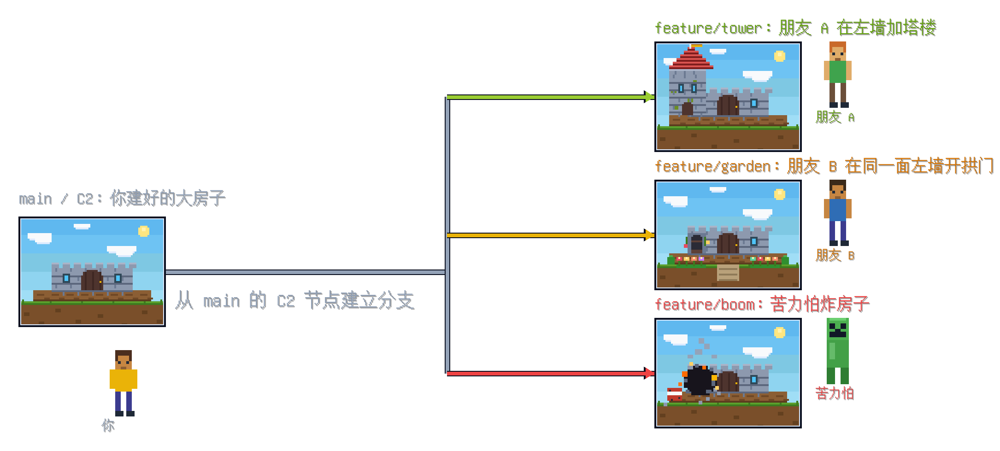
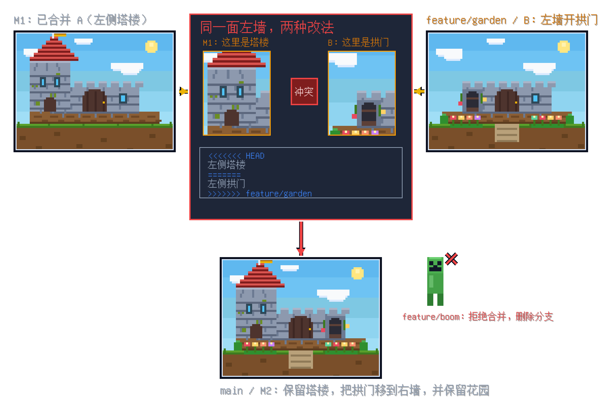
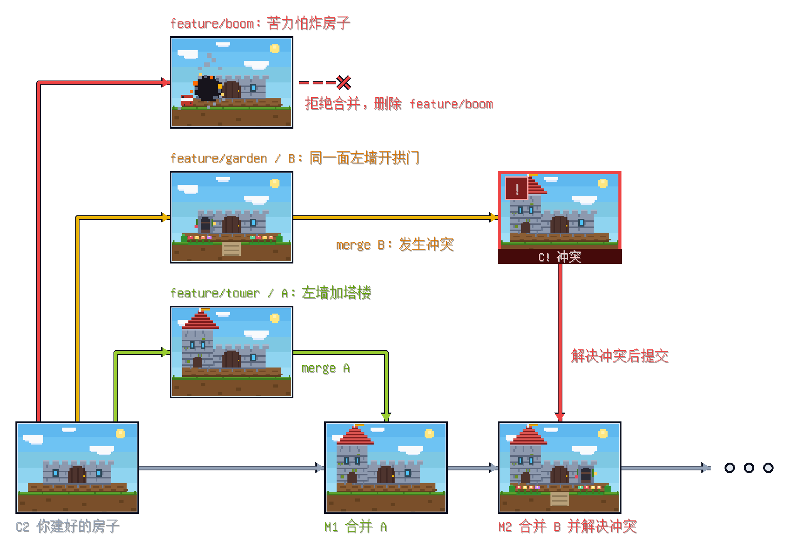

## 用 Minecraft 类比理解 Git

可以把 `main` 想成大家的 Minecraft 主世界：你当前建造的世界是工作目录；给世界拍一张带备注的存档（`commit`）；`branch` 是从当前存档复制出来的平行世界；`merge` 是把平行世界的改动搬回主世界；如果两个人改了同一面墙，就会发生冲突，需要手动决定保留哪些方块。

### 建造大型建筑：从主分支的同一个基础上开分支

假设你要建一栋大房子：先打好地基、砌好墙和城门，这就是 `main` 上的 C2。现在有两位朋友来帮忙，还有一个“朋友”其实是苦力怕。

- 朋友 A 开分支 `feature/tower`，在你建好的房子左侧墙加塔楼；
- 朋友 B 开分支 `feature/garden`，也在**同一面左侧墙**开拱门，并在门前加花园；
- 苦力怕开分支 `feature/boom`，在左墙放 TNT，把房子炸了。



### 合并多个分支：为什么会冲突？

先合并 A：

```bash
git checkout main
git merge --no-ff feature/tower    # 得到 M1：塔楼合并进 main
```

再合并 B：

```bash
git merge --no-ff feature/garden   # 合并 B 时发生冲突
```

问题出现了：A 和 B 都改了左侧墙的同一段内容——A 把它变成了塔楼，B 把它改成了拱门。Git 无法判断你更想要哪种设计，于是报告**冲突（conflict）**。

你需要手动编辑文件，决定或重新设计最终结果。例如：保留左侧塔楼，把拱门移到右侧墙，同时保留花园。修改完成后：

```bash
git add <冲突文件>
git commit -m "merge: 解决塔楼与拱门的冲突"
```

如果暂时不想解决，可以执行 `git merge --abort` 放弃这次合并，回到合并前的状态。

解决冲突并提交后，`main` 得到 M2。接下来处理苦力怕的分支：**它不应该合并进 main，直接丢弃即可。**

```bash
# 不要执行 git merge feature/boom
git checkout main
git branch -D feature/boom                 # 删除本地分支
git push origin --delete feature/boom      # 如果远程也创建了这个分支
```

`git branch -D` 会强制删除尚未合并的分支，这里正是我们想要的效果。如果之前已经尝试合并并停在冲突中，先执行 `git merge --abort`，再删除分支。



## 总览

如图所示：

